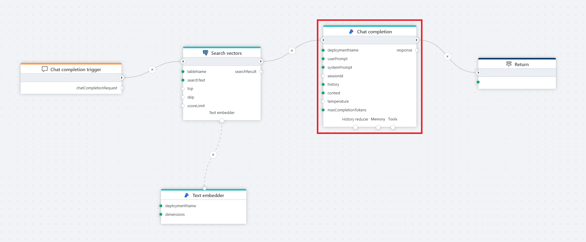

# Chat Completion

This defines an [Microsoft Foundry](https://ai.azure.com/) chat completion model that processes a prompt, understands the user’s intent, and generates the next response. Using chat completion provides structured reasoning, allows the model to follow context, and helps maintain a coherent dialogue.   

This action is typically used in flows where you need the model’s complete output in a single, finalized response instead of receiving partial tokens over time.
Unlike the [streaming](streaming-chat-completion.md) version, this action delivers the **complete output in one response**.

**Example**   
This flow processes a user's chat question by first receiving it through a [Chat completion](../../triggers/ai/chat-completion-trigger.md) trigger, then converting it into a vector using a [text embedder](../azure-ai/text-embedder.md), performing a [Vector search](../postgresql/vector-search.md) in a PostgreSQL database for relevant context, and finally passing the user input and retrieved context to an Azure AI **Chat completion** action, which generates a response that is returned to the client via the [Return](../built-in/return.md) node.

 

## Properties

| Name                  | Required | Description |
|-----------------------|-----------|-------------|
| Title             | No | The title of the action. |
| Connection        | Yes | Defines the [connection](azure-ai-connection.md) to **Microsoft Foundry** resource. |
| Enable dynamic connection   | No |    A [Dynamic Connection](create-connection.md) will override the [connection](azure-ai-connection.md) on flow execution.   |
| Model             | Yes | Specifies the model deployment name, which corresponds to the custom name chosen during model deployment in the Azure portal or in [Microsoft Foundry](https://ai.azure.com) ([see below](#models--endpoints)). In the Azure Portal, the deployment name can be found under **Resource Management** > **Model Deployments**. |
| User Prompt       | Yes | The input message from the user, which the model processes to generate a response. |
| System Prompt     | No | A system-level instruction that guides the model’s behavior and response style. |
| Session ID        | No | Identifies the conversation. A session ID is required if you want to use [memory](#memory), allowing for an ongoing conversation rather than every interaction starting fresh. The session ID is usually provided by the client, for example through the [Chat completion trigger](../../triggers/ai/chat-completion-trigger.md). |
| History           | No | A record of past interactions that provides context to the conversation, helping the model maintain continuity. |
| Context           | No | Typically used for RAG, and provides additional information or domain-specific knowledge to the chat model so it can make more accurate responses. The input can be a string (text) or a vector search result, such as the result from the PostgreSQL [Vector Search](../postgresql/vector-search.md) action. |
| Prompt template   | No | Defines the structure of the prompt sent to the model. The system replaces the placeholders @@context and @@userPrompt with the relevant information. See example below. |
| Temperature       | No |Temperature in models controls the randomness and creativity of the generated responses. Lower temperatures (e.g., 0.2) produce more focused, predictable text, ideal for tasks that require precision. Higher temperatures (e.g., 1.5) increase creativity and variability, but may risk generating less coherent or relevant content, making it important to adjust based on your desired outcome.  The default is 0.7 if nothing is defined by the user.|
| Max Completion Tokens | No | Sets a limit on the number of tokens (words, characters, or pieces of text) in the model’s response. |
| Result Variable Name | No | Stores the generated AI response. Default: "response". |
| Enable Grounding        | No | Enables grounding to improve factual accuracy using external or structured context. |
| History reducer   | No | Connect a [chat history reducer](../ai/chat-history-truncation-reducer.md) to limit the size of the conversation history sent to the model. |
| Memory | No | Connect a memory action to store and retrieve previous messages in the conversation, allowing for an ongoing conversation with the AI. Note that memory requires a **Session ID**. |
| Tools             | No | Connect one or more tools the model can call to perform tasks while generating the response. Supported tools are the [Vector search tool](../sql-server/vector-search-tool.md) and the [Web search tool](../tavily/web-search-tool.md). |
| Disabled                | No | If enabled, the action is skipped during flow execution. |
| Description       | No | Additional details or notes regarding the chat completion setup. |

 

## Returns

The action returns a single **AIChatCompletionResponse** object containing the generated message, token usage details, finish reason, and the raw Azure response.

 

#### Models + Endpoints
To find the Model deployment name, look in `Models` screen in [Microsoft Foundry](https://ai.azure.com).  

 

#### Prompt template

The prompt template allows you to specify the format of the prompt that is sent to the language model. This is useful for customizing how context and instructions are provided to the model.
Within the template, you can use the following placeholders:

- `@@context`: This is replaced by the "Context" property value.
- `@@userPrompt`: This is replaced by the "User prompt" property value.

The system will substitute these placeholders with the corresponding values before sending the prompt to the model.

**Example**  

  

 

[!INCLUDE ]