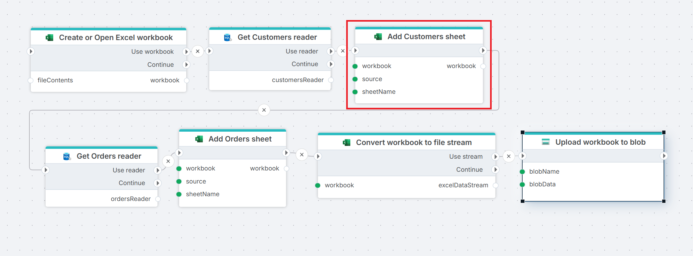

# Add sheet to Excel workbook

Adds a sheet to an Excel workbook from a [DataTable](https://learn.microsoft.com/en-us/dotnet/api/system.data.datatable) or [DataReader](https://learn.microsoft.com/en-us/dotnet/api/system.data.idatareader). Each sheet has its own column mapping and formatting, so sheets in the same workbook can have completely different structures. Use the action several times, or inside a loop, to build a workbook with multiple sheets.

**Example**   
This Flow exports customers and orders from SQL Server to one Excel file with two sheets. [Create or Open Excel workbook](./open-workbook.md) creates an empty workbook, and **Get Customers reader** ([Get DataReader](../sql-server/get-datareader.md)) runs in its **Use workbook** branch. **Add Customers sheet** takes the `workbook`, uses `customersReader` as `source`, and sets `sheetName` to name the new sheet. The `workbook` output is then passed to **Add Orders sheet**, which adds a second sheet from `ordersReader` with its own column mapping and formatting. After both sheets are added, **Convert workbook to file stream** ([Convert Excel workbook to file stream](./convert-workbook-to-file-stream.md)) produces the file, and **Upload workbook to blob** ([Upload Blob](../azure-blob-storage/upload-blob.md)) saves it to Azure Blob Storage.

 

## Properties

| Name                         | Required | Description |
| ---------------------------- | -------- | ----------- |
| Title                        | No | The title of the action. |
| Workbook                     | No | The workbook to add the sheet to, typically the output of [Create or Open Excel workbook](./open-workbook.md). If omitted, a new workbook is created. |
| Source                       | Yes | Specifies the source of the data, which can either be a DataTable or DataReader. |
| Sheet name                   | No | The name of the new sheet. If omitted, the first available name in the sequence `Sheet 1`, `Sheet 2`, etc. is used. See [Sheet names](#sheet-names). |
| Column mapping               | No | Defines the mapping between Excel column letters and source column names for this sheet. If no mapping is defined, all columns from the source are exported. |
| Worksheet formatting options | No | Specifies detailed formatting options for this sheet. |
| Workbook variable name       | No | The name of the variable you can use to reference the workbook in other actions. |
| Disabled                     | No | When checked, the action is skipped during Flow execution. |
| Description                  | No | Additional notes or comments about the action or configuration. |

 

## Returns

The Excel workbook with the new sheet added. If `Workbook` was provided, this is the same workbook. If `Workbook` was omitted, this is a new workbook.

 

## Sheet names

Sheet names are adjusted automatically to be valid in Excel:

- Characters that are not allowed in Excel sheet names are replaced.
- Names longer than 31 characters are truncated.
- If a sheet with the same name already exists (case-insensitive), a suffix such as ` (2)` is added.

 

## Remarks

- New sheets are always added after the existing sheets in the workbook. Existing sheets are never overwritten.
- If the source contains no rows, a sheet with only the header row is created. A source with no columns causes an error.
- When using a DataReader, all rows are read immediately, but the DataReader is not closed by this action.
- When using the output of [Create or Open Excel workbook](./open-workbook.md), run this action inside its **Use workbook** branch. Add all sheets before converting the workbook to a file — sheets cannot be added after conversion.
- Add sheets one after the other. Do not add sheets to the same workbook in parallel.

 

### Automatic column mapping

Columns can be mapped automatically by using the "Map from sample file" option.

 

## See also

- [Create or Open Excel workbook](./open-workbook.md) — creates a new workbook or opens an existing Excel file.
- [Convert Excel workbook to file bytes](./convert-workbook-to-file-bytes.md) — converts the workbook to a byte array.
- [Convert Excel workbook to file stream](./convert-workbook-to-file-stream.md) — converts the workbook to a stream.

 

[!INCLUDE ]
