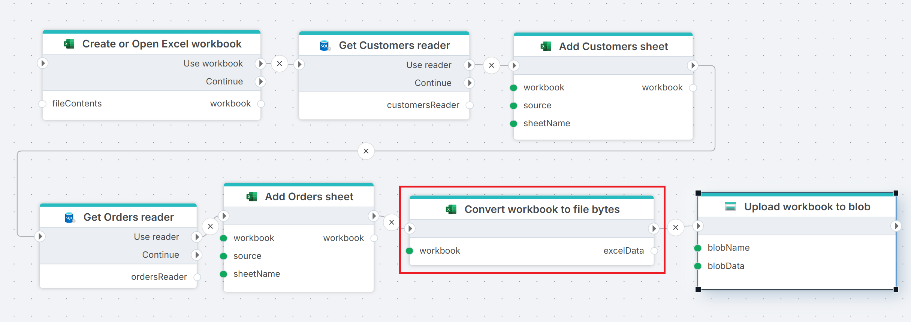

# Convert Excel workbook to file bytes

Converts an Excel workbook, with all its sheets, to an Excel file and returns it as a `byte array`. Use this action after all sheets have been added with [Add sheet to Excel workbook](./add-sheet.md).

**Example**   
This Flow exports customers and orders from SQL Server to one Excel file with two sheets. [Create or Open Excel workbook](./open-workbook.md) creates an empty workbook, and inside its **Use workbook** branch, **Add Customers sheet** and **Add Orders sheet** ([Add sheet to Excel workbook](./add-sheet.md)) add one sheet each from SQL Server DataReaders ([Get DataReader](../sql-server/get-datareader.md)). **Convert workbook to file bytes** takes the finished `workbook` and returns the file as the byte array `excelData`. The next action, **Upload workbook to blob** ([Upload Blob](../azure-blob-storage/upload-blob.md)), uploads `excelData` to Azure Blob Storage as `blobData`.

 

## Properties

| Name                     | Required | Description |
| ------------------------ | -------- | ----------- |
| Title                    | No | The title of the action. |
| Workbook                 | Yes | The workbook to convert, typically the output of [Create or Open Excel workbook](./open-workbook.md) or [Add sheet to Excel workbook](./add-sheet.md). |
| Byte array variable name | No | The name of the variable you can use to reference the byte array in other actions. |
| Disabled                 | No | When checked, the action is skipped during Flow execution. |
| Description              | No | Additional notes or comments about the action or configuration. |

 

## Returns

Returns the Excel file serialized as a [byte](https://learn.microsoft.com/en-us/dotnet/api/system.byte) [array](https://learn.microsoft.com/en-us/dotnet/csharp/language-reference/builtin-types/arrays). The file is in `.xlsx` format, or `.xlsm` if the workbook was opened from a macro-enabled file.

 

## Remarks

- Run this action inside the **Use workbook** branch of [Create or Open Excel workbook](./open-workbook.md), after all sheets have been added.
- The workbook must contain at least one sheet.
- After conversion, no more sheets can be added to the workbook. Converting the same workbook again is allowed.
- Use the byte array inside the **Use workbook** branch, or assign it to a variable declared outside the branch if you need it after the branch completes.
- For large files, consider [Convert Excel workbook to file stream](./convert-workbook-to-file-stream.md) instead, to avoid an extra copy of the file in memory.

 

## See also

- [Create or Open Excel workbook](./open-workbook.md) — creates a new workbook or opens an existing Excel file.
- [Add sheet to Excel workbook](./add-sheet.md) — appends a sheet from a DataTable or DataReader.
- [Convert Excel workbook to file stream](./convert-workbook-to-file-stream.md) — converts the workbook to a stream.

 

[!INCLUDE ]
