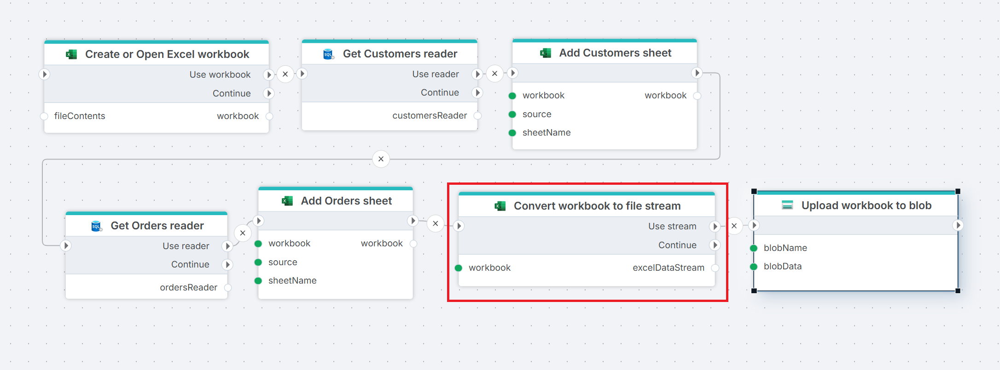

# Convert Excel workbook to file stream

Converts an Excel workbook, with all its sheets, to an Excel file and returns it as a [Stream](https://learn.microsoft.com/en-us/dotnet/api/system.io.stream). Use this action after all sheets have been added with [Add sheet to Excel workbook](./add-sheet.md).

**Example**   
This Flow exports customers and orders from SQL Server to one Excel file with two sheets. [Create or Open Excel workbook](./open-workbook.md) creates an empty workbook, and inside its **Use workbook** branch, **Add Customers sheet** and **Add Orders sheet** ([Add sheet to Excel workbook](./add-sheet.md)) add one sheet each from SQL Server DataReaders ([Get DataReader](../sql-server/get-datareader.md)). **Convert workbook to file stream** takes the finished `workbook` and returns the file as `excelDataStream`. **Upload workbook to blob** ([Upload Blob](../azure-blob-storage/upload-blob.md)) is connected to the **Use stream** branch and uploads the stream to Azure Blob Storage as `blobData`. When the **Use stream** branch completes, the stream is closed automatically and the Flow continues from **Continue**.

 

## Properties

| Name                 | Required | Description |
| -------------------- | -------- | ----------- |
| Title                | No | The title of the action. |
| Workbook             | Yes | The workbook to convert, typically the output of [Create or Open Excel workbook](./open-workbook.md) or [Add sheet to Excel workbook](./add-sheet.md). |
| Stream variable name | No | The name of the variable you can use to reference the Stream in other actions. |
| Disabled             | No | When checked, the action is skipped during Flow execution. |
| Description          | No | Additional notes or comments about the action or configuration. |

 

## Returns

Returns the Excel file as a [Stream](https://learn.microsoft.com/en-us/dotnet/api/system.io.stream), positioned at the beginning. The file is in `.xlsx` format, or `.xlsm` if the workbook was opened from a macro-enabled file.

 

## Output ports

| Port           | Description |
| -------------- | ----------- |
| **Use stream** | Runs while the stream is available. Connect uploads and other actions that read the stream here. |
| **Continue**   | Runs after the **Use stream** branch has completed and the stream has been closed. |

 

## Remarks

- Run this action inside the **Use workbook** branch of [Create or Open Excel workbook](./open-workbook.md), after all sheets have been added.
- The workbook must contain at least one sheet.
- The stream is closed automatically when the **Use stream** branch completes, also if an error occurs. Do not use the stream from the **Continue** port.
- After conversion, no more sheets can be added to the workbook. Converting the same workbook again is allowed.
- This action avoids the extra byte array copy made by [Convert Excel workbook to file bytes](./convert-workbook-to-file-bytes.md), but both the workbook and the stream are kept in memory.

 

## See also

- [Create or Open Excel workbook](./open-workbook.md) — creates a new workbook or opens an existing Excel file.
- [Add sheet to Excel workbook](./add-sheet.md) — appends a sheet from a DataTable or DataReader.
- [Convert Excel workbook to file bytes](./convert-workbook-to-file-bytes.md) — converts the workbook to a byte array.

 

[!INCLUDE ]
