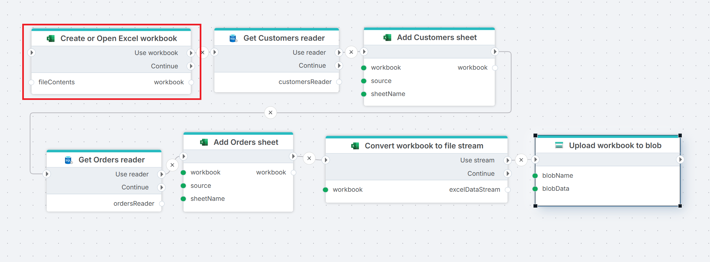

# Create or Open Excel workbook

Creates a new, empty Excel workbook, or opens an existing `.xlsx` or `.xlsm` file, so you can add one or more sheets to it. Use this action together with [Add sheet to Excel workbook](./add-sheet.md) and [Convert Excel workbook to file bytes](./convert-workbook-to-file-bytes.md) or [Convert Excel workbook to file stream](./convert-workbook-to-file-stream.md) when you need to produce an Excel file with multiple sheets, or append sheets to an existing file.

**Example**   
This Flow exports customers and orders from SQL Server to one Excel file with two sheets. **Create or Open Excel workbook** leaves `fileContents` empty, so it creates a new, empty workbook and exposes it as `workbook` in the **Use workbook** branch. Inside that branch, **Get Customers reader** ([Get DataReader](../sql-server/get-datareader.md)) provides `customersReader`, which **Add Customers sheet** ([Add sheet to Excel workbook](./add-sheet.md)) writes to the first sheet. **Get Orders reader** and **Add Orders sheet** then add the orders to a second sheet in the same workbook. Finally, **Convert workbook to file stream** ([Convert Excel workbook to file stream](./convert-workbook-to-file-stream.md)) produces `excelDataStream`, which **Upload workbook to blob** ([Upload Blob](../azure-blob-storage/upload-blob.md)) saves to Azure Blob Storage from the **Use stream** branch. When the **Use workbook** branch completes, the workbook is closed automatically. To add sheets to an existing file instead, connect a byte array or stream to `fileContents`.

 

## Properties

| Name                    | Required | Description |
| ----------------------- | -------- | ----------- |
| Title                   | No | The title of the action. |
| File contents           | No | An existing Excel file (`.xlsx` or `.xlsm`), provided as either a stream or a byte array. Leave empty to create a new, empty workbook. |
| Workbook variable name  | No | The name of the variable you can use to reference the workbook in other actions. |
| Disabled                | No | When checked, the action is skipped during Flow execution. |
| Description             | No | Additional notes or comments about the action or configuration. |

 

## Returns

An Excel workbook object that you pass to the `Workbook` property of [Add sheet to Excel workbook](./add-sheet.md), [Convert Excel workbook to file bytes](./convert-workbook-to-file-bytes.md) and [Convert Excel workbook to file stream](./convert-workbook-to-file-stream.md).

 

## Output ports

| Port             | Description |
| ---------------- | ----------- |
| **Use workbook** | Runs while the workbook is open. Connect all actions that work with the workbook here, including loops, **Add sheet** and **Convert workbook** actions. |
| **Continue**     | Runs after the **Use workbook** branch has completed and the workbook has been closed. |

 

## Remarks

- When `File contents` is provided, the existing sheets are preserved, and new sheets are appended after them. Existing sheets are never overwritten.
- If a new sheet has the same name as an existing sheet, a suffix such as ` (2)` is added to make the name unique.
- Macro-enabled workbooks (`.xlsm`) keep their format and VBA project when converted back to a file. Legacy `.xls` files are not supported.
- The original file contents are not modified. To keep the changes, convert the workbook to a file and save or upload the result.
- All workbook operations must run inside the **Use workbook** branch, one after the other. The workbook is closed and released automatically when the branch completes, also if an error occurs.
- This action does not read data from the worksheets. To read data from an Excel file, use [Convert Excel file to DataReader](./open-excel-file-as-datareader.md), [Convert Excel file to DataTable](./read-excel-file-as-datatable.md) or [For each row in Excel file](./for-each-row.md).
- To create a file with a single sheet from a DataTable or DataReader, [Convert DataTable or DataReader to Excel file bytes](./create-excel-file-as-byte-array.md) or [Convert DataTable or DataReader to Excel file stream](./create-excel-file-as-stream.md) is simpler.

 

## See also

- [Add sheet to Excel workbook](./add-sheet.md) — appends a sheet from a DataTable or DataReader.
- [Convert Excel workbook to file bytes](./convert-workbook-to-file-bytes.md) — converts the workbook to a byte array.
- [Convert Excel workbook to file stream](./convert-workbook-to-file-stream.md) — converts the workbook to a stream.

 

[!INCLUDE ]
