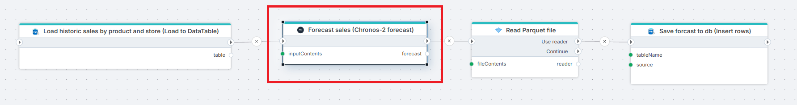

# Chronos-2 forecast

Use Chronos-2 to forecast future values of one or many time series (for example product sales, demand or prices) from their history. The model makes predictions on your data without ever being trained on it, so there is no per-series training.  
It is a good fit when you have many series, short or sparse histories, or want probabilistic forecasts (quantiles) rather than a single number. Don’t use it when you need an interpretable trend/seasonality breakdown, irregular timestamps, or non-numeric targets.

  
**Example**    
The example above illustrates a Flow where historic sales data is loaded from a business system (SQL Server database), forecasted using the Chronos-2 model and then saved back to the database for review.

<br/>

## Properties
| Name             | Required     | Description                                |
|------------------|--------------|--------------------------------------------|
| History data     | Yes          | A **CSV** or **Parquet** file (byte array or stream), **DataTable** or **IDataReader** containing the historic time series (in tabular format) to forecast. |
| Input file format | No          | Required if the input is a file (**byte array** or **stream**). |
| ID column(s)     | Yes          | One or more column names that, for example `ProductID` or `ProductID, StoreID` |
| Timestamp column | Yes          | The name of the column that contains the timestamp of the observation / historc value. |
| Target column    | Yes          | The name of the column that contains the observation / historic value to predict future values from. |
| Frequency        | Yes          | The frequency of the time series data. Valid values are **D** = Day, **W** = Week, **MS** = MonthStart, **ME** = MonthEnd. Defaults to `ME`. |
| Prediction length | Yes         | The number of periods to forecast. Relative to Frequency. Example: Frequency = ME,  Prediction length = 12 => 1 Year. |
| Output file format | Yes        | The file format of the returned result. Valid values are `parquet` or `csv`. Default is `parquet`.

<br/>

## Returns
Returns a **CSV** or **Parquet** file as a byte array.

The returned file contains the following columns:  

| Name      | Description                           |
|-----------|---------------------------------------|
| item_id   | Concatenated ID columns(s) separated by double pipes (&vert;&vert;) |
| timestamp |The prediction timestamp.  |
| target_name | The name of the target column passed in as historic data set. Can be used by downstream nodes to identity which value was predicted. |
| prediction | The predicted value. |
| quantile_0_1 | The low-end estimate. |
| quantile_0_9 | The high-end estimate. |
| The ID column(s) | Each ID column(s) provided in the input. |

**Example**  

| item_id           | ProductID | StoreID | timestamp           | prediction | quantile_0_1 | quantile_0_9 |
|-------------------|-----------|---------|---------------------|------------|--------------|--------------|
| P1&vert;&vert;S1  | P1        | S1      | 2025-01-01T00:00:00 | 13.5       | 11.4         | 17.7         |
| P1&vert;&vert;S1  | P1        | S1      | 2025-02-01T00:00:00 | 12.5       | 10.4         | 15.7         |

<br/>

## Note on input (history) data
- **ID columns** cannot contain null values. Rows with null values will be ignored by the forecaster.
- Timestamps cannot contain gaps. For example, you cannot provide a dataset with [January, March, April], skipping February.

## Chronos-2 Forecasting: Explained

> **Source project:** [amazon-science/chronos-forecasting](https://github.com/amazon-science/chronos-forecasting) (Apache-2.0 licence)  
> **Research paper:** Ansari et al., *Chronos-2: From Univariate to Universal Forecasting*, [arXiv:2510.15821](https://arxiv.org/abs/2510.15821)  

<br/>

### 1. What is Chronos-2?

Chronos-2 is a **pretrained AI forecasting model** from Amazon. It looks at the history of something that changes over time (daily sales, electricity demand, website traffic) and predicts what is likely to happen next.

Three things set it apart:

1. **Ready to use.** It has already been trained on a very large and varied collection of patterns. You do not need to build or train a custom model for each dataset. This is called *zero-shot* forecasting.
2. **Context-aware.** It can take into account related data and outside factors, such as promotions, prices, holidays or weather.
3. **Honest about uncertainty.** Instead of one number, it gives a most-likely forecast plus a range of plausible outcomes.

#### An analogy

Imagine two analysts:

- **Analyst A** is new. They spend weeks studying only your company's history before producing a first forecast. This is the traditional approach: build and tune a model for each dataset.
- **Analyst B** has already seen thousands of demand, traffic and energy patterns. They glance at your data, recognise the weekly rhythms, seasonal swings and trends, and give you a forecast on day one.

Chronos-2 behaves like Analyst B.

<br/>

### 2. What can I use it for?

Any situation where you have numbers recorded over time and want to know what comes next.

| Area | Example questions |
|---|---|
| **Finance & planning** | What is the expected revenue or cash flow for the next quarter? |
| **Retail & supply chain** | How many units of each product will each store sell next week? When should we reorder? |
| **Energy & utilities** | What will electricity demand or prices look like over the next 24 hours? |
| **IT & operations** | How much server capacity or cloud spend will we need next month? |
| **Customer service** | How many calls will arrive per hour tomorrow? How many agents do we need? |
| **Web & marketing** | What traffic should we expect after the planned campaign? |

<br/>

### 3. Key capabilities in plain English

| Capability | What it means | Example |
|---|---|---|
| **Single-series forecasting** (*univariate*) | Forecast one series from its own history | Next month's sales of Product A |
| **Related-series forecasting** (*multivariate*) | Forecast several connected series together so they inform each other | Predict CPU and memory usage jointly, since one hints at the other |
| **Outside-factor forecasting** (*covariate-informed*) | Include external information that influences the outcome | Use the promotion calendar and holidays to forecast demand |
| **Learning across series** (*cross-learning*) | Share insight between many similar series | A slow-selling product benefits from patterns seen in similar products |

According to the project, the largest accuracy gains appear on tasks that include outside factors. The more relevant context you can supply, the more the model can help.

<br/>

### 4. How does it work?

#### 4.1 The big picture

```
 ┌─────────────────────┐       ┌──────────────────────┐       ┌────────────────────────┐
 │ 1. Pretraining      │       │ 2. You provide       │       │ 3. You receive         │
 │ (done once, by      │  ──►  │ your history +       │  ──►  │ a forecast with a      │
 │ Amazon)             │       │ optional context     │       │ range of likely values │
 └─────────────────────┘       └──────────────────────┘       └────────────────────────┘
```

#### 4.2 Step by step

1. **Pretraining (already done for you).** The model learned general forecasting skills from a very large body of time series. Much of the training data is *synthetic*: artificially generated series with realistic relationships between them. This matters because real-world datasets showing how many related series influence each other are scarce.
2. **You supply your data.** This is your history, plus optionally related series and information about the future that you already know (for example, planned promotions).
3. **The model reads the data and looks for patterns.** It breaks each series into small chunks called *patches* and examines them in two ways:
   - **Across time:** what happened earlier in this series? (trends, seasonality, recent shifts)
   - **Across related series:** what do the other series in the same group suggest? This is the "group attention" mechanism, and it is what allows Chronos-2 to use outside factors and related data.
4. **It adapts on the fly.** The model does not retrain itself on your data. It uses your data as *context*, in the same way you can give a chatbot a few examples and it adjusts its answer. This is called *in-context learning*.
5. **It returns a forecast with uncertainty.** You choose how far ahead to predict and which probability levels (*quantiles*) you want to see.

<br/>

### 5. What goes in and what comes out

#### 5.1 Input data

Your data should be organised as a table (for example a CSV file or spreadsheet export) with at least three columns:

| Column | Purpose | Example |
|---|---|---|
| **ID** | Identifies which series each row belongs to | `store_12_product_A` |
| **Timestamp** | When the value was recorded | `2026-03-15 00:00` |
| **Target** | The value you want to forecast | `148` (units sold) |

You may add further columns for outside factors, which come in two kinds:

| Type | Description | Example |
|---|---|---|
| **Past-only factors** | Known only up to today | Last week's competitor price, actual weather so far |
| **Known-future factors** | Values that are already decided or reliably known for the forecast period | Planned promotions, public holidays, scheduled price changes |

**Example input**

| id | timestamp | sales | promotion | price |
|---|---|---|---|---|
| store_1 | 2026-03-01 | 120 | 0 | 9.99 |
| store_1 | 2026-03-02 | 135 | 1 | 8.99 |
| store_1 | 2026-03-03 | 118 | 0 | 9.99 |
| store_2 | 2026-03-01 | 80 | 0 | 9.99 |
| … | … | … | … | … |

#### 5.2 Output

For each series and each future time step, you receive:

| Output | Meaning |
|---|---|
| **Central forecast** | The most likely value (the median, or 50% quantile) |
| **Lower bound** | A cautious value, e.g. the 10% quantile: only a 10% chance the real value will be lower |
| **Upper bound** | An optimistic value, e.g. the 90% quantile: only a 10% chance the real value will be higher |

Together, the 10% and 90% quantiles form an **80% prediction interval**.

#### 5.3 How to read a forecast

- **Treat the band as the planning range, not the line.** The central forecast is a best guess, not a promise.
- **Use the band to match the risk.** If running out of stock is costly, plan closer to the upper bound. If over-spending is the bigger risk, plan closer to the lower bound.
- **A wide band is information.** It tells you the model is less certain, which may mean noisy data, a short history or an unusual period.

```
 Value
   │                                    ╱‾‾‾‾  upper (90%)
   │                           ╱‾‾‾‾‾‾‾╱
   │  ‾‾╲    ╱‾╲    ╱‾‾╲     ╱─────────  central forecast (50%)
   │      ╲╱     ╲╱      ╲╱ ╲╱───────
   │                           ╲_______  lower (10%)
   └───────────────────────────────────────► Time
         history          │     forecast
                        today
```

<br/>

### 6. Is Chronos-2 right for my use case?

### 6.1 Good fit

- ✅ You have regularly recorded data (daily, weekly, hourly, etc.)
- ✅ You have a meaningful history (more is generally better, and it should include at least a few repeating cycles such as several weeks or seasons)
- ✅ You have many series and cannot build a custom model for each
- ✅ You want a quick, strong baseline forecast
- ✅ You have useful outside factors (promotions, holidays, prices) and want them taken into account
- ✅ You need to express uncertainty, not just a single number

#### 6.2 Think twice

- ⚠️ **Almost no history.** A brand-new product or a series with only a handful of data points will be uncertain whatever the method.
- ⚠️ **Events that have never happened before.** Pandemics, regulatory shocks or a new competitor cannot be predicted from history.
- ⚠️ **You need to know *why* something will happen.** Chronos-2 finds patterns. It does not prove cause and effect.
- ⚠️ **Poor data quality.** Missing values, wrong timestamps and unrecorded one-off events (such as a stock-out that suppressed sales) will degrade results.
- ⚠️ **Regulated or high-stakes decisions.** Always keep a human in the loop and validate results first.

<br/>

### 7 Preparing your data

Before you run a forecast, check the following:

- [ ] Every row has an ID, a timestamp and a target value
- [ ] Timestamps are consistent (e.g. all daily, no mixing of daily and weekly)
- [ ] Gaps and missing values are understood and handled
- [ ] Known one-off events (outages, stock-outs, data-entry errors) are flagged or corrected
- [ ] Outside factors are correctly aligned to the same timestamps
- [ ] For known-future factors, values are provided for the **entire forecast period**
- [ ] You have decided how far ahead you want to forecast (the *horizon*)

### 8. Running a forecast - typical workflow

1. **Load** your history (and optional outside factors).
2. **Choose** the forecast horizon (e.g. 24 hours, 12 weeks).
3. **Run** the forecast.
4. **Review** the results visually against recent history.
5. **Export** or share the output.

<br/>

### 9. Checking that the forecast is trustworthy

Never adopt a forecasting method purely on reputation. Test it on your own data.

#### 9.1 Back-testing

1. Pick a past period (e.g. the last 8 weeks) and **hide** it from the model.
2. Forecast that period using only the data before it.
3. Compare the forecast with what actually happened.
4. Repeat for several different past periods if you can.

#### 9.2 Compare against your current method

Run the same back-test with whatever you use today (a spreadsheet trend, an existing model, last year's numbers). Chronos-2 is worth adopting if it is clearly better, or similar in accuracy but much faster and cheaper to maintain.

#### 9.3 Check the ranges, not just the central line

If you request an 80% interval, roughly 80% of real outcomes should fall inside it. If far fewer do, the ranges are too narrow to rely on. If nearly all do, they may be wider than necessary.

#### 9.4 Common accuracy measures

| Measure | Plain meaning |
|---|---|
| **MAE** (mean absolute error) | On average, how far off the forecast was, in the original units |
| **MAPE / sMAPE** | Average error as a percentage of the actual value |
| **Coverage** | How often reality fell inside the prediction interval |

> *Choose measures that match how the forecast is used in your business.*

<br/>

### 10. Limitations and good practice

| Limitation | What to do |
|---|---|
| Finds correlation, not causation | Don't use the forecast as proof that a factor *caused* an outcome |
| Cannot foresee unprecedented events | Maintain scenario planning alongside the forecast |
| Sensitive to data quality | Clean and review the data before running forecasts |
| "Zero-shot" is not always "best" | A tuned in-house model may still win on some datasets, so back-test |
| Future factors must be realistic | If planned promotions or prices change, re-run the forecast |
| Forecasts age quickly | Refresh regularly as new data arrives |
| Performance claims are from the developers | Benchmark results are published by the authors; always confirm on your own data |

**Good practice**

- Start with a pilot on a few important series before rolling out widely.
- Keep a human review step for decisions with significant financial or operational impact.
- Document which data, model version and settings produced each forecast, so results can be reproduced.

<br/>

### 11. Frequently asked questions

**Do I need to train the model on my data?**
No. Chronos-2 works "zero-shot" and uses your data as context at the time of forecasting. Some teams may optionally fine-tune for specialised needs. That is a data-science task and is outside the scope of this guide.

**Is my data sent to Amazon?**
Chronos-2 is open-source software that you can run in your own environment. Where your data goes depends on how your organisation has deployed it (for example, within your own AWS account). *Confirm with your IT or data-protection team.*

**How much history do I need?**
There is no fixed rule. As a practical guide, include enough history to cover several repetitions of any cycles that matter (e.g. multiple weeks for weekly patterns, at least a year or more for annual seasonality).

**Can it forecast many products or stores at once?**
Yes. You can forecast many series in one run, and the model can learn across related series.

**What if I have no outside-factor data?**
That is fine. Chronos-2 works on history alone. Outside factors are optional but can improve accuracy when they are genuinely relevant.

**Why is my forecast range so wide?**
Common causes are noisy data, a short history, recent unusual events or a long forecast horizon. Wide ranges are an honest signal of uncertainty.

**Can I trust the forecast for important decisions?**
Use it as decision support, validate it with back-testing and combine it with business judgement.

<br/>

### 12. Glossary

| Term | Plain-English meaning |
|---|---|
| **Time series** | A measurement recorded repeatedly over time |
| **Forecast horizon** | How far into the future you are predicting |
| **Pretrained model / foundation model** | A model trained broadly in advance, then reused for many tasks |
| **Zero-shot** | Using a model on new data without any additional training |
| **In-context learning** | The model adapts to your data by reading it as context, without being retrained |
| **Covariate** | An outside factor that may influence the outcome (price, weather, promotion) |
| **Past-only covariate** | An outside factor known only up to the present |
| **Known-future covariate** | An outside factor whose future values are already known |
| **Univariate / multivariate** | One series / several related series |
| **Cross-learning** | Improving forecasts by learning from many similar series |
| **Quantile** | A probability level, e.g. the 90% quantile is a value the outcome is expected to stay below 90% of the time |
| **Prediction interval** | The range between a lower and upper quantile |
| **Back-test** | Testing a forecast method against past data where the answer is already known |
| **Fine-tuning** | Optional extra training of a model on your own data |

---

## Appendix A: Technical notes for data scientists

### A.1 Architecture

- **Transformer-based** model that splits each series into **patches**.
- Each transformer block **alternates** between two attention types:
  - **Time attention:** aggregates information across patches *within* a single series.
  - **Group attention:** aggregates information across all series *within a group* at the same patch index.
- A **group** is a flexible notion of relatedness. It can be a single series, a set of series sharing a source or metadata, the variates of a multivariate series, or targets together with their covariates.
- Group attention shares information across the batch axis rather than concatenating targets and covariates into a longer context, so it scales well with the number of variates.
- This design provides **in-context learning (ICL)** across arbitrary numbers of targets and covariates, so one model handles univariate, multivariate and covariate-informed tasks.

### A.2 Training data

- Training relies heavily on **synthetic** series generated by imposing multivariate structure on series drawn from base univariate generators. This addresses the scarcity of high-quality real multivariate and covariate-rich datasets.
- The paper also studies training on synthetic data alone versus a mixed corpus, and the effect of long-context post-training.

### A.3 Outputs

- **Probabilistic forecasts** returned as quantiles (configurable via `quantile_levels`).

### A.4 Supported task types

| Task | Supported |
|---|---|
| Univariate forecasting | ✅ |
| Multivariate forecasting | ✅ |
| Past-only covariates | ✅ |
| Known (future) covariates | ✅ |
| Categorical covariates | ✅ |
| Cross-learning across series | ✅ |

<br/>

## Appendix B: Further reading

- Project repository: <https://github.com/amazon-science/chronos-forecasting>
- Chronos-2 paper: <https://arxiv.org/abs/2510.15821>
- Amazon Science blog: <https://www.amazon.science/blog/introducing-chronos-2-from-univariate-to-universal-forecasting>
- Original Chronos paper: <https://arxiv.org/abs/2403.07815>
- Quick-start notebook: <https://github.com/amazon-science/chronos-forecasting/blob/main/notebooks/chronos-2-quickstart.ipynb>
- AutoGluon-Cloud deployment guide: <https://auto.gluon.ai/cloud/stable/tutorials/foundation-model-timeseries.html>

<br/>

## Chronos-2 vs Prophet 
Need help deciding which forecasting model to use? Read the comparison between Chronos-2 and Prophet below.  

[Chronos-2 vs Prophet](./chronos-2-vs-prophet.md)
