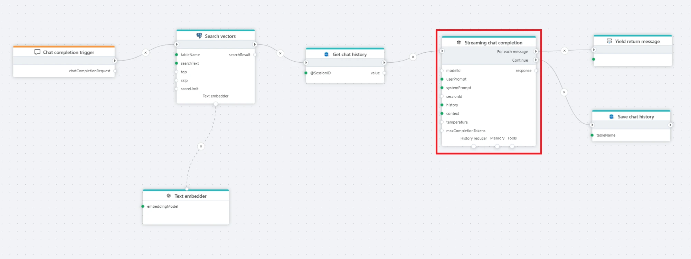

# Streaming chat completion

This action defines an [OpenAI](https://platform.openai.com/docs) streaming chat completion model that processes a prompt and delivers the response in small pieces as it is generated. Using a streaming chat completion improves responsiveness and gives the user real-time insight into the model’s output as it forms.

It's typically used when building backends for interactive chat clients, assistant-like experiences, or any UI that needs incremental model output.  
Unlike the standard [chat completion](chat-completion.md), this action returns the response **incrementally as it is generated**.

**Example**   
The example above shows a Flow that provides chat completions to a chat client. We're using [PostgreSQL vector search](../postgresql/vector-search.md) to enable RAG, and SQL Server to store and retrieve the chat history so that users can ask follow-up questions.

 

 
## Properties

| Name                  | Required | Description |
|-----------------------|-----------|-------------|
| Title                 | No | The title of the action. |
| Connection            | Yes | Defines the [connection](openai-connection.md) to **OpenAI**. |
| Model id              | Yes | ID of the chosen [model](https://platform.openai.com/docs/models). |
| System prompt         | No | A system-level instruction that guides the model’s behavior and response style. |
| User prompt           | Yes | The input message from the user, which the model processes to generate a response. |
| Session ID        | No | Identifies the conversation. A session ID is required if you want to use [memory](#memory), allowing for an ongoing conversation rather than every interaction starting fresh. The session ID is usually provided by the client, for example through the [Chat completion trigger](../../triggers/ai/chat-completion-trigger.md). |
| History               | No | A record of past interactions that provides context to the conversation, helping the model maintain continuity. |
| Context               | No | Additional context information to influence the response (if supported). |
| Prompt template   | No | Defines the structure of the prompt sent to the model. The system replaces the placeholders @@context and @@userPrompt with the relevant information. See example below. |
| Temperature           | No | Controls randomness/creativity of responses. Lower = more focused; higher = more creative. Default: 0.7. |
| Max completion tokens | No | Sets a limit on the number of tokens in the model’s response. |
| Result variable name  | No | Stores the generated AI response. Default: `response`. |
| Enable Grounding        | No | Enables web search to improve factual reliability by using external or structured context sources. |
| History reducer   | No | Connect a [chat history reducer](../ai/chat-history-truncation-reducer.md) to limit the size of the conversation history sent to the model. |
| Memory | No | Connect a memory action to store and retrieve previous messages in the conversation, allowing for an ongoing conversation with the AI. Note that memory requires a **Session ID**. |
| Tools             | No | Connect one or more tools the model can call to perform tasks while generating the response, such as an [MCP client tool](../mcp/mcp-client-tool.md) or a [Flow AI tool](../ai/flow-ai-tool.md). |
| Disabled                | No | If enabled, the action will be skipped during flow execution. |
| Description           | No | Additional details or notes regarding the chat completion setup. |

 

#### Prompt template

The prompt template allows you to specify the format of the prompt that is sent to the language model. This is useful for customizing how context and instructions are provided to the model.
Within the template, you can use the following placeholders:

- `@@context`: This is replaced by the "Context" property value.
- `@@userPrompt`: This is replaced by the "User prompt" property value.

The system will substitute these placeholders with the corresponding values before sending the prompt to the model.

**Example**  

  
