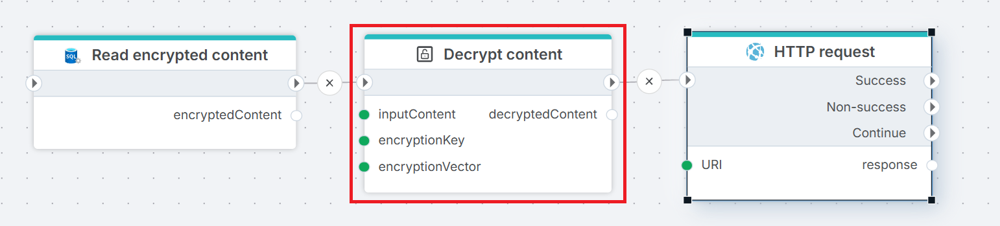

# AES Decrypt

Decrypts content using the [AES](https://en.wikipedia.org/wiki/Advanced_Encryption_Standard) algorithm.

**Example**   
This flow decrypts a stored secret and uses it when calling an external API. A SQL Server [Get entity](../sql-server/get-entity.md) action reads the encrypted content from a database, the AES Decrypt action decrypts it using the same key and initialization vector that were used to [encrypt](aes-encrypt.md) it, and an [HTTP request](../http/http-request.md) action uses the decrypted content in its call to the API. 

 

## Properties

| Name                   | Required | Description                                                                                                                       |
| ---------------------- | -------- | --------------------------------------------------------------------------------------------------------------------------------- |
| Title                  | No       | The title of the action.                                                                                                          |
| Encryption key         | Yes      | The key used to decrypt the content. This must be the same key that was used to encrypt the content.                              |
| Initialization vector  | Yes      | The vector used to decrypt the content. This must be the same vector that was used to encrypt the content.                        |
| Input content          | Yes      | The content to be decrypted (string or byte array).                                                                               |
| Output variable name   | Yes      | The name of the variable in which the result will be stored.                                                                      |
| Output data type       | Yes      | The data type of the output variable. This can be either a string (Base64 encoded) or a byte array.                               |
| Description            | No       | Additional notes or comments about the action or configuration.                                                                   |

 

## Returns

This action returns the decrypted content as a string or a byte array, depending on the selected output data type.
