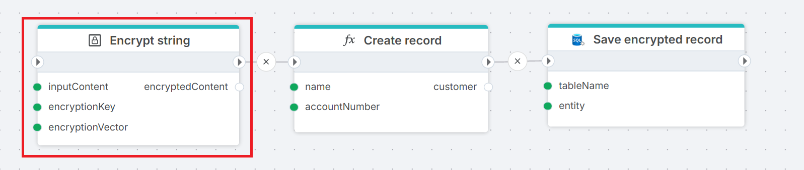

# AES Encrypt

Encrypts content using the [AES](https://en.wikipedia.org/wiki/Advanced_Encryption_Standard) algorithm.

**Example**   
This flow protects a customer's account number before it is stored. The AES Encrypt action encrypts the account number, a [Function](../built-in/function.md) action creates a customer record with the customer name and the encrypted account number, and a SQL Server [Insert Entity](../sql-server/insert-entity.md) action saves the record to a database table. Use the [AES Decrypt](aes-decrypt.md) action to read the account number back.

 

## Properties

| Name                   | Required | Description                                                                                                                       |
| ---------------------- | -------- | --------------------------------------------------------------------------------------------------------------------------------- |
| Title                  | No       | The title of the action.                                                                                                          |
| Encryption key         | Yes      | The key used to encrypt the content. This is required by the AES algorithm. The length of the key is 256 bit.                     |
| Initialization vector  | Yes      | The vector used to encrypt the content.                                                                                           |
| Input content          | Yes      | The content to be encrypted (string or byte array).                                                                               |
| Output variable name   | Yes      | The name of the variable in which the result will be stored.                                                                      |
| Output data type       | Yes      | The data type of the output variable. This can be either a string (Base64 encoded) or a byte array.                               |
| Description            | No       | Additional notes or comments about the action or configuration.                                                                   |

 

## Returns

This action returns the encrypted content as a Base64 encoded string or a byte array, depending on the selected output data type.
