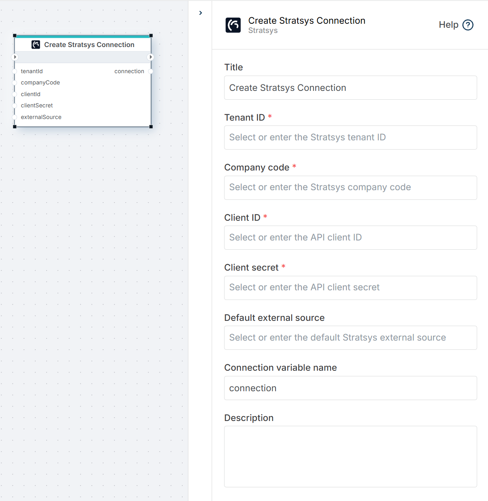

# Create Stratsys connection

This action creates a connection for Stratsys and is intended for dynamically connecting to different tenants based on parameters or conditions during the execution of a Flow.

If you store the credentials outside Flow (for example, in your own Azure SQL or PostgreSQL database), use this action to *dynamically* create a connection. The connection returned from the action can be used as the input to the `Dynamic connection` property of the [Push data to Stratsys KPI API](./push-data-to-kpi-api.md), [REST API Request](./rest-api-request.md), and [REST API Request with paging](./paged-rest-api-request.md) actions. When set, the `Dynamic connection` overrides the action's `Connection` during Flow execution.

 

 

## Authentication mode

Select how the connection authenticates. The properties shown depend on the selected mode.

| Mode | Description |
|------|-------------|
| OAuth client credentials | Authenticates with a Tenant ID, Client ID, and Client secret. This is the default. |
| SCIM bearer token | Authenticates with a pre-generated SCIM key. Required for the SCIM endpoints (`v1/scim/...`). |

See [Connecting to Stratsys](./connection.md#authentication-modes) for guidance on which mode to use.

 

## Properties

| Name                    | Applies to | Required | Description                                                     |
|-------------------------|------------|----------|-----------------------------------------------------------------|
| Title                   | Both | No | The title of the action. |
| Authentication mode     | Both | Yes | **OAuth client credentials** (default) or **SCIM bearer token**. |
| Tenant ID               | OAuth | Yes | The Stratsys tenant ID. |
| Company code            | Both | Yes | The Stratsys company code. It determines the API address (`https://<company code>.api.stratsys.com`). |
| Client ID               | OAuth | Yes | The API client ID. |
| Client secret           | OAuth | Yes | The API client secret. |
| SCIM key                | SCIM | Yes | The pre-generated SCIM key. Use a secret workspace variable. |
| Default external source | Both | No | The default source system, as defined in Stratsys, to tag data with. Type the value directly into this field. Can be overridden per action on [Push data to Stratsys KPI API](./push-data-to-kpi-api.md), or with the `Stratsys-ExternalSource` header on the REST API Request actions. Required by [Push data to Stratsys KPI API](./push-data-to-kpi-api.md) and the `v1/external/...` endpoints unless set on the action or request. |
| Connection variable name | Both | Yes | The name of the variable you can use to reference the connection in other actions — for example, as the **Dynamic connection** of a Stratsys action. |
| Description             | Both | No | Additional notes or comments about the action or configuration. |

The connection is returned on the **connection** output port.

 

## Creating Client ID with Secret

You generate the Client ID and Client Secret in Stratsys. See the [Stratsys documentation](https://www.stratsys.com/) for how to create API credentials.

 

## Creating a SCIM key

You generate the SCIM key in Stratsys. See the [Stratsys documentation](https://www.stratsys.com/) for how to generate a SCIM key. The key must not contain whitespace.
