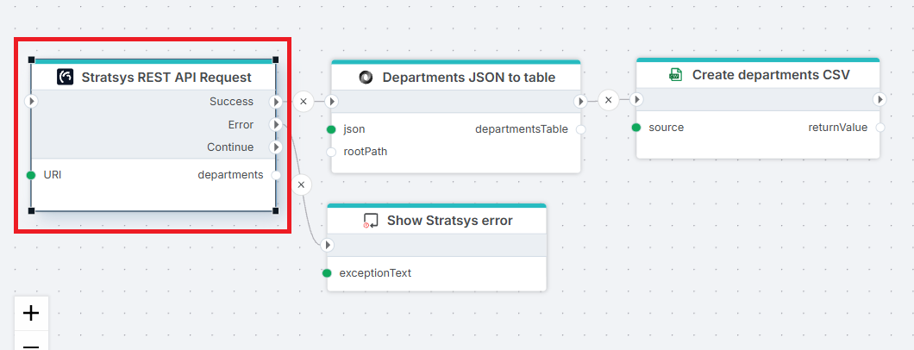

# Stratsys REST API Request

The **REST API Request** action allows you to interact with the Stratsys REST API to read or write data. You can retrieve information such as KPI data, departments, users, scorecards, nodes, or export views, or call other Stratsys endpoints using HTTP methods (`GET`, `POST`, `PUT`, `PATCH`, `DELETE`).

The action sends a single request and returns a single response. It does not aggregate paged data. For endpoints that return paginated collections, such as SCIM users and groups or due diligence data, use [REST API Request with paging](./paged-rest-api-request.md).

**Example**   
This flow reads departments from Stratsys and saves them as a CSV file. **Stratsys REST API Request** calls the departments endpoint at the given `URI` and returns the response as `departments`. On **Success**, **Departments JSON to table** ([Convert JSON to DataTable](../json/get-json-datatable.md)) converts the JSON response to the DataTable `departmentsTable`, and **Create departments CSV** ([Create CSV file as byte array](../csv/create-csv-file-as-byte-array.md)) uses the table as `source` to create the CSV file. On **Error**, **Show Stratsys error** ([Throw exception](../built-in/throw-exception.md)) stops the Flow with an error message. Use this pattern to handle a failed API call in the Flow itself, instead of wrapping the action in a [Try-Catch](../built-in/try-catch.md) block.

 

## Properties

| Name             | Required |Description                                             |
|------------------|-----------|--------------------------------------------------------|
| Title  | No | The title or name of the request. |
| Connection | Yes | The [Stratsys Connection](./connection.md) used to make an authenticated request to the Stratsys REST API. |
| Dynamic connection | No | Use this option if you need to use a connection created by the [Create Stratsys connection](./create-connection.md) action. |
| Configuration | Yes | Define configuration as described below. |
| Description | No | Additional notes or comments about the action or configuration. |

 

## Returns

To maximize compatibility and performance, we recommend using the [HttpResponse&lt;T&gt;](../../api-reference/built-in-types/http-response.md) type. This provides:
- The raw response body.
- Additional details such as the HTTP status code and any errors.

For further processing, store the raw JSON response in a database or file storage, and use data transformation tools to convert it into the required format.

 

## Configuration

### Defining a REST API Request

To define a request to the Stratsys REST API, you can start from a template, or define it manually.
If you press the `New Request` button in the Configuration dialog, you can choose from a set of predefined request templates.

The Stratsys REST API is large, so the template collection contains only a subset of the available APIs. The templates are grouped as follows:

| Group | Templates |
|-------|-----------|
| Export views | Get export view by ID |
| KPIs | Get KPI data, Get KPI data columns |
| Organization | Get departments, Get department, Get users, Get user, Get groups, Get group |
| Scorecards | Get scorecards, Get scorecard, Get scorecard column |
| Nodes | Get nodes on department, Get node on department, Get node keywords, Get node descriptions |
| External IDs | Get available resource types, Get external IDs by resource type, Get internal ID by external ID |

If you cannot find a template for the request you want to make, you can refer to the Stratsys API documentation for your tenant and define the request manually. Which endpoints you can call depends on the API permissions granted to your Stratsys tenant and credentials.

1. **Method**: Choose the appropriate HTTP method for your request. Templates use `GET`.
   - `GET`: Retrieve data from Stratsys (e.g., get departments or KPI data).
   - `POST`: Create new records.
   - `PUT` / `PATCH`: Update existing records.
   - `DELETE`: Remove records.

2. **URI**: Specify the endpoint for your request, relative to your Stratsys API address. For example:
   - `v1/departments`: To read departments.
   - `v2/kpis/{nodeId}/data`: To read KPI data.

   Templates that contain placeholders such as `{id}` or `{nodeId}` must have the placeholder replaced with a real value (or a variable) before the action runs.

3. **Headers**:
   - Authentication is automatically set up from the connection settings.
   - `Stratsys-Version`: Added by templates for endpoints that require it. Defaults to `Active`.
   - `Stratsys-ExternalSource`: Used by the External ID endpoints. If you leave it empty, the **Default external source** from the connection is used. A value entered in the header overrides the connection value. If neither is set, requests to `v1/external/...` endpoints fail with an error.

4. **Parameters**: Add query or body parameters as required by the endpoint. Use variables or fixed values based on your workflow to customize the request. Query parameters with an empty value are not sent, so you can leave optional filters blank.

5. **Response Type**: Use the default `HttpResponse<string>` to work with raw JSON data. For large datasets, this approach is recommended to reduce memory usage and improve performance.

 

## Execution outputs

| Port | Description |
|------|-------------|
| Success | Runs when the request completes without throwing. When the response type is [HttpResponse&lt;T&gt;](../../api-reference/built-in-types/http-response.md), this includes unsuccessful HTTP responses, so check `IsSuccess` before processing the content. |
| Error | Runs when the action raises an error, such as a failed authentication or an unsuccessful HTTP response with a response type other than `HttpResponse<T>`. The error details are available through the `apiException` variable (`Message`, `StatusCode`, `ResponseContent`, `InnerException`). |
| Continue | Runs after the Success or Error port has completed. |

 

## Error handling

If the response from the Stratsys request is of type [HttpResponse&lt;T&gt;](../../api-reference/built-in-types/http-response.md), the response object includes an `IsSuccess` property. If `IsSuccess` is false, the response object will contain an `ErrorContent` property, which relays error messages from the API call or internally thrown exceptions.

For other response types or severe errors, the action will raise an error that could terminate the Flow unless the **Error** port is connected or the action is wrapped in a [Try-Catch](../built-in/try-catch.md) block.

 

## API Limits

Stratsys enforces rate limits to maintain stable server performance. If you exceed these limits, the API will return a `429 Too Many Requests` error.
For `GET` requests, the action handles this by delaying the call and retrying up to three attempts in total. If the retry limit is reached, an error is returned. Requests using other methods are not retried.
