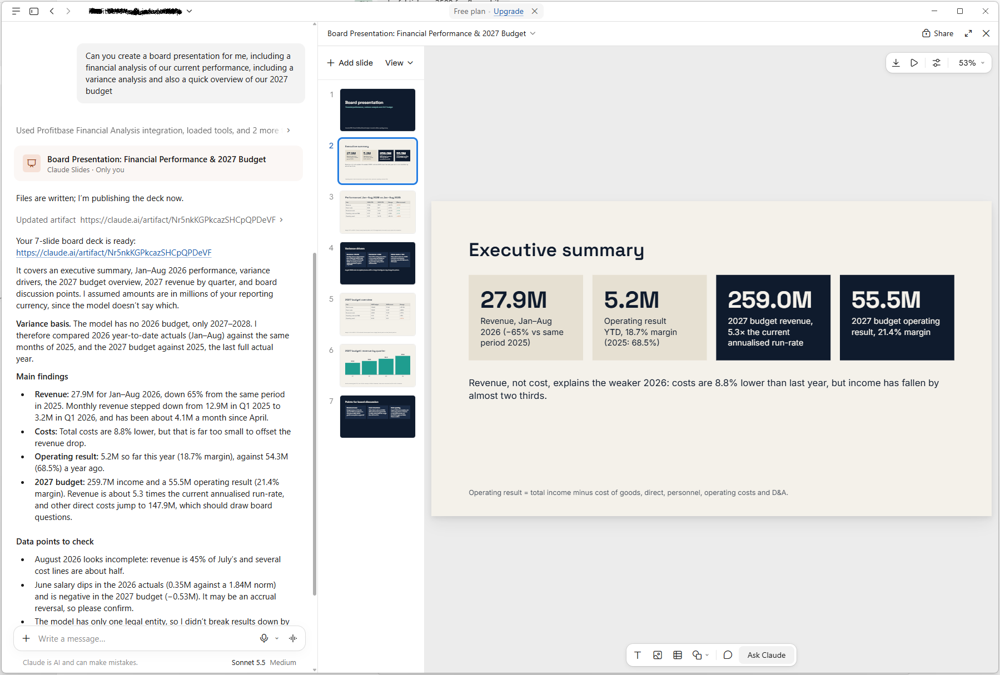
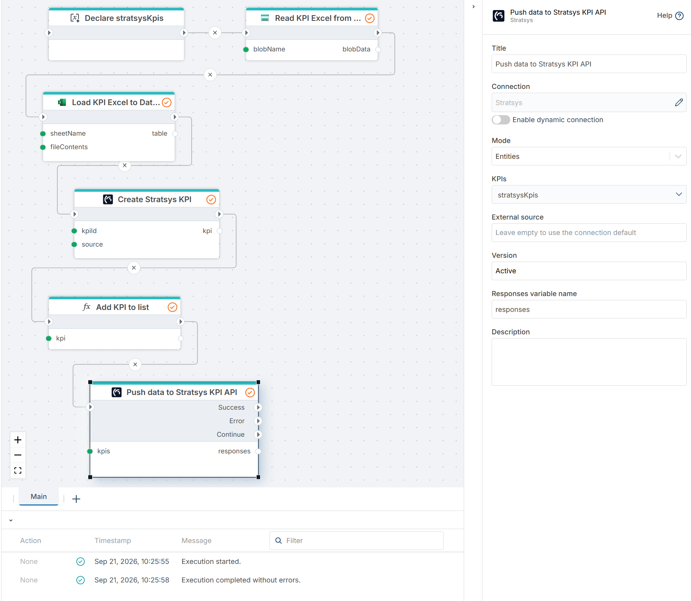
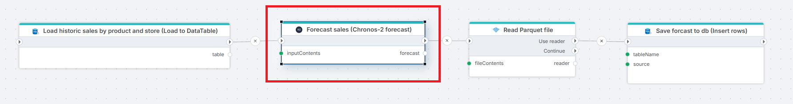
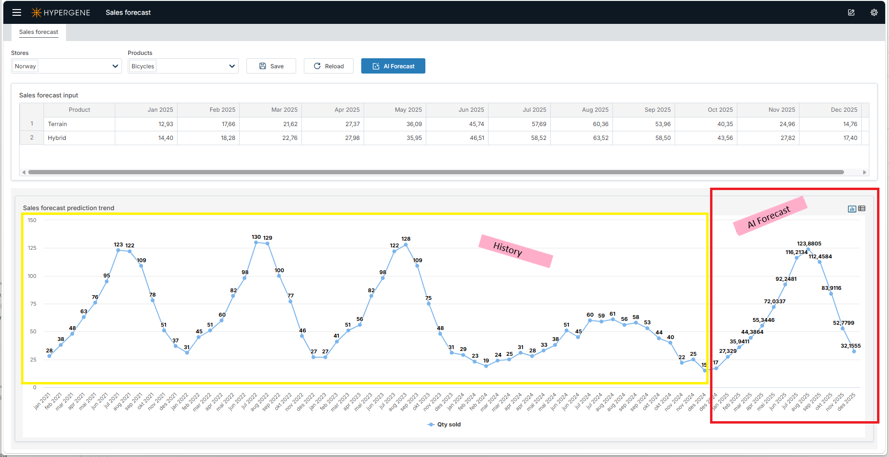

# Flow November 2026 update

The November 2026 update brings business data closer to AI agents through **semantic models and MCP**. Additionally, built-in connectors for **Stratsys** and **Monitor ERP** let you push and pull data without custom code, and the new Chronos-2 action adds zero-shot forecasting of one or many time series.

## MCP enabled Semantic Layer
[Semantic models](../semantic-models/overview.md) bring a governed, business-language layer on top of your SQL Server data. A semantic model defines entities and dimensions, measures and metrics, relationships, hierarchies, and business rules such as time intelligence, currency handling and row-level access. The meaning of your data is defined once and reused by every consumer.

Every semantic model automatically gets an **MCP server** that exposes the semantic layer (not the raw database) to AI agents. The server provides the tools an agent needs to discover metrics, query and analyze data, and build dashboards and reports. It works with native Hypergene AI agents as well as third-party clients such as `Claude Cowork`, `Claude Code`, `VS Code` and `M365 Copilot`.

Typical use cases:
- Building `PowerPoint` board reports with `M365 Copilot` or `Claude`.
- Creating operational reports and dashboards.
- AI-powered ad-hoc data analysis.
- Conversational Q&A over business data, without writing SQL.

Why it works better than text-to-SQL on raw tables:
- **Accuracy and consistency**: agents select governed metrics instead of inventing calculations, so "Revenue" means the same in a dashboard and in chat.
- **Security**: access control is enforced in the semantic layer, with the user's identity passed through (for example via OAuth), so the AI can't see more than the user can.
- **Safety**: tools are limited to read-only, parameterized queries. There is no arbitrary SQL execution.
- **Explainability and cost**: agents work from a curated metric catalog and can cite the metric definitions behind an answer.

Learn more: [Semantic models](../semantic-models/overview.md), [Getting started](../semantic-models/getting-started.md), [Connecting MCP clients](../semantic-models/mcp/connect-mcp-clients.md) and [Security](../semantic-models/mcp/security.md).

 

## Stratsys API integration
Connect your flows to [Stratsys](../actions/stratsys/overview.md) with new built-in actions covering both the targeted Stratsys KPI API for data ingestion, and the generic REST API. Push data from SQL Server, a data platform, Excel or any other source Flow supports into Stratsys, so plans and reports stay current without manual entry. You can also read data out of Stratsys, such as KPI data, departments, users, scorecards, SCIM users and due diligence data.

What's included:
- **Connection**: a [Stratsys connection](../actions/stratsys/connection.md) using a Company code and either **OAuth client credentials** (Tenant ID, Client ID, Client Secret) or a **SCIM bearer token**. Flow handles authentication and token refresh. Use [Create Stratsys connection](../actions/stratsys/create-connection.md) to build a connection at runtime, for example when you work with multiple Stratsys tenants from the same flow.
- **Push KPI data**: [Create Stratsys KPI entity](../actions/stratsys/create-kpi-entity.md) maps a DataTable or DataReader onto the fields the KPI API expects. [Push data to Stratsys KPI API](../actions/stratsys/push-data-to-kpi-api.md) sends prebuilt entities (**Entities** mode) or pushes directly from a DataTable (**Tabular** mode, with no separate build step).
- **Call the REST API**: [REST API Request](../actions/stratsys/rest-api-request.md) calls any Stratsys endpoint. [REST API Request with paging](../actions/stratsys/paged-rest-api-request.md) handles paginated collections such as SCIM users and groups, with configurable paging mode, items per page and max page count. Both actions offer built-in request templates and handle `429 Too Many Requests` by delaying and retrying automatically.

Learn more: [Stratsys overview](../actions/stratsys/overview.md).

 

## Chronos-2 Forecasting capability
The new [Chronos-2 forecast](../actions/machine-learning/chronos-2-forecast.md) action lets you forecast future values of one or many time series, such as product sales, demand or prices, from their history. Chronos-2 is a pretrained forecasting model from Amazon. It works *zero-shot*: it makes predictions from your data without being trained on it, so there is no per-series model to build or tune.

Typical use cases:
- Forecasting demand for thousands of products or stores in a single run.
- Producing a quick baseline forecast for series with short or sparse histories.
- Financial planning, such as expected revenue or cash flow for the next quarter.
- Capacity and workload planning in IT and operations.

What's included:
- **Many series at once**: identify each series with one or more **ID columns** (for example `ProductID, StoreID`) and forecast all of them in one action.
- **Flexible input**: read history from a **DataTable**, an **IDataReader**, or a **CSV** or **Parquet** file (byte array or stream).
- **Probabilistic forecasts**: the result contains the predicted value together with a low-end (`quantile_0_1`) and high-end (`quantile_0_9`) estimate, so you can plan against a range instead of a single number.
- **Simple configuration**: choose the frequency (day, week, month start or month end) and the number of periods to forecast. The result is returned as **Parquet** or **CSV**, ready to save back to your database for review.

Not sure whether to use Chronos-2 or the existing Prophet action? Chronos-2 is a good fit for many series, short histories and when speed to first forecast matters. Prophet is the better choice when you need to explain the forecast component by component. See [Chronos-2 vs Prophet](../actions/machine-learning/chronos-2-vs-prophet.md) and back-test both on your own data.

Learn more: [Chronos-2 forecast](../actions/machine-learning/chronos-2-forecast.md).

 

## Monitor ERP integration
Integrate with [Monitor ERP](../actions/monitor-erp/overview.md) using new built-in actions on top of the Monitor ERP REST API. Read data such as vouchers, accounts, customer invoices, employees and financial years from Monitor ERP into SQL Server, a data platform or any other destination Flow supports. You can also create, update and delete records in Monitor ERP from your flows.

What's included:
- **Connection**: a [Monitor ERP connection](../actions/monitor-erp/connection.md) using Host, Language code, Company number, and the username and password of a regular Monitor ERP user. Use [Create Monitor ERP connection](../actions/monitor-erp/create-connection.md) to build a connection at runtime, for example when credentials are stored in your own database or when you work with multiple Monitor ERP companies from the same flow.
- **Call the REST API**: [REST API Request](../actions/monitor-erp/rest-api-request.md) calls any Monitor ERP endpoint with `GET`, `POST`, `PUT` or `DELETE`. [REST API Request with paging](../actions/monitor-erp/paged-rest-api-request.md) handles paginated endpoints such as voucher and invoice lists, with configurable start page, items per page and max page count. Both actions offer built-in request templates, or you can define requests manually, and both handle `429 Too Many Requests` by delaying and retrying automatically.
- **Built for large data sets**: store the raw JSON response in a data store and transform it afterwards, or flatten smaller results directly with the JSON to DataReader action.

Learn more: [Monitor ERP overview](../actions/monitor-erp/overview.md).
