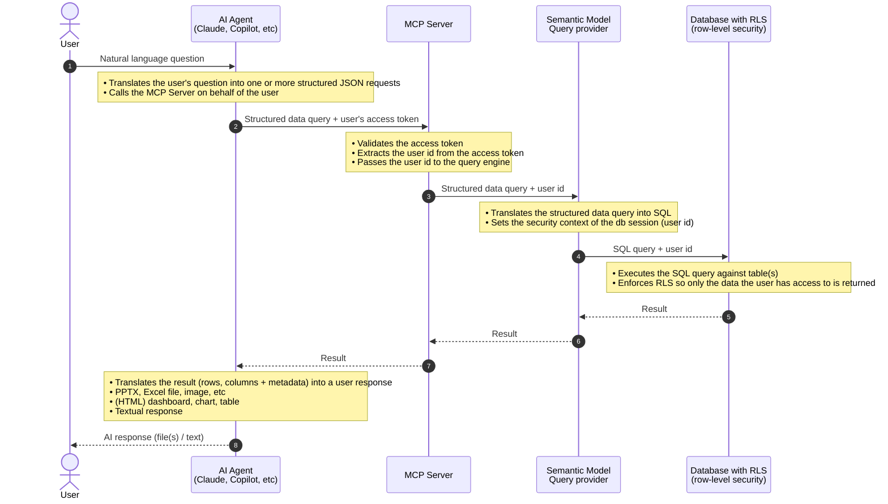

# Security via Semantic Model MCP Server

This document describes how the Semantic Model MCP Server enforces data access permissions, so users only see the data they are allowed to see.

> [!IMPORTANT]
> Data access through MCP services requires that the [OAuth connection option](./connect-mcp-clients.md#connect-with-oauth) is used when connecting to the Semantic Model MCP Server.

 

## Row-level security
The Semantic Model MCP Server itself does not enforce data access permissions. Instead, it relies on the underlying database (for example SQL Server) to handle this.
This way, users and access control rules stay in the source system and do not have to be duplicated in the MCP Server.  
The MCP Server only validates that the request from the AI agent is authenticated on behalf of a user. It then passes the user id to the database, where RLS policies are enforced when the MCP Server fetches data.

> [!NOTE]
> For row-level security to work, make sure the [MCP Security Context](./configure-mcp-security-context.md) is configured in the Semantic Model.

## Description
The sections below describe the prerequisite setup and how security is enforced, so users only see data they have access to.

### Add MCP connector to AI tool
As part of the setup required to connect any AI tool like Claude or Copilot to an MCP Server, the tool takes the user through an authentication process when the connection is set up. It typically follows this pattern:

1. The user adds an MCP connection to the AI tool (for example, a custom connection in Claude).
2. The AI tool discovers that the MCP Server requires user authentication.
3. The AI tool takes the user through the authentication process.
4. The AI tool can now call the MCP Server on behalf of the user.

 

### Request flow with access control enforcement
The following diagram shows how a user request flows through service layers, and what each layer is responsible for in enforcing security.

