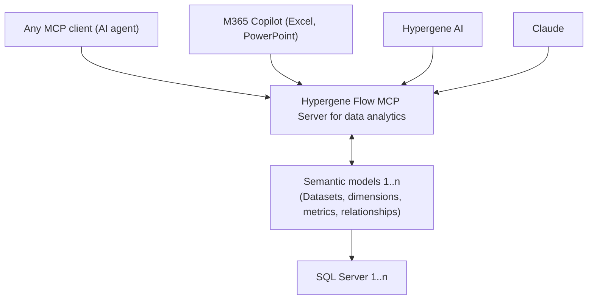

# Semantic models

Semantic models in Flow make your business data available to AI agents securely and reliably via the Model Context Protocol (MCP). 

Raw databases are hard for AI to use. Tables are named FCT_GL_TRX_V2, columns are cryptic, and business rules such as “net revenue excludes internal transfers” live in people’s heads or in BI reports. An LLM that writes SQL against raw schemas will often return plausible but wrong numbers.

**What a semantic model adds**  
A semantic model is a governed business-language layer on top of physical data. It defines:  
- **Entities and dimensions**: Customer, Product, Cost Center, Period, with friendly names and descriptions
- **Measures and metrics**: Revenue, Gross Margin, Headcount, each with one canonical calculation
- **Relationships**: how entities join, so the AI doesn’t guess join paths
- **Hierarchies**: account → account group → P&L line; department → division
- **Business rules and security**: time-intelligence logic (YTD, vs. budget), currency handling, row-level access

The _meaning_ of the data is defined once and reused by every consumer.  

**MCP**  
When you create a semantic model in Flow, you automatically get an MCP server with all the tools an AI agent needs to query your business data, analyze it, and build dashboards and reports. This works with native Hypergene AI agents, and with agents built in third-party apps such as `Claude Cowork` or `M365 Copilot`.  

>[!NOTE]
> The MCP server sits in front of the semantic layer and exposes it, not the raw database.

Typical use cases include:

- Building `PowerPoint` board reports with `M365 Copilot` or `Claude`.
- Creating operational reports and dashboards.
- AI-powered ad-hoc data analysis.
- Conversational Q&A over your business data, where users get answers in plain language without writing SQL queries.

 

A typical flow:

1. A user asks, “Why is marketing over budget in Q3?”
2. The AI calls list_metrics or reads the catalog, and finds Actual, Budget, Variance and the Cost Center dimension.
3. It calls `query_metrics(metrics=[Variance], dimensions=[Account], filters={cost_center: Marketing, period: Q3})`.
3. The semantic layer compiles that into correct SQL or a query, applying the canonical definitions, joins and the user’s permissions.
5. The AI receives structured results and explains them, citing which metric definitions it used.

**Why this works better than text-to-SQL on raw tables**  
- **Accuracy**: the AI selects governed metrics instead of inventing calculations. “Revenue” means the same thing in a dashboard and in chat.
- **Consistency**: one definition serves all AI clients and BI tools.
- **Security**: access control is enforced in the semantic layer, with the user’s identity passed through (for example via OAuth), so the AI can’t see more than the user can.
- **Smaller context and cost**: the model sees a curated catalog of metrics, not thousands of tables.
- **Explainability**: answers can reference metric names and definitions, which makes them auditable.
- **Safety**: tools are constrained to read-only, parameterized queries, so there’s no arbitrary SQL execution and less risk of expensive or destructive queries.

 

#### Continue reading
[Getting started](./getting-started.md)  
[Connecting MCP Clients](./mcp/connect-mcp-clients.md)  
[Security](./mcp/security.md)
