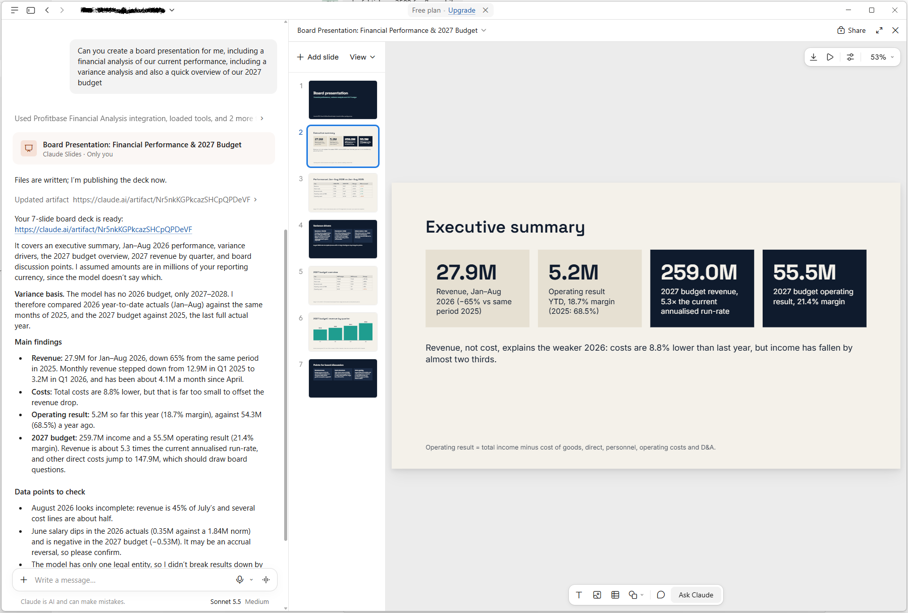
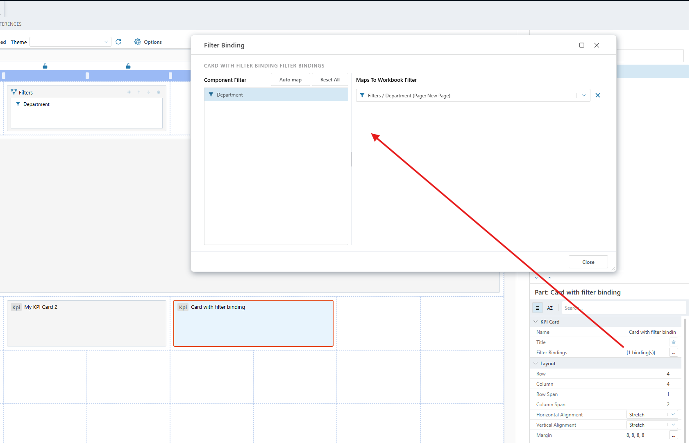
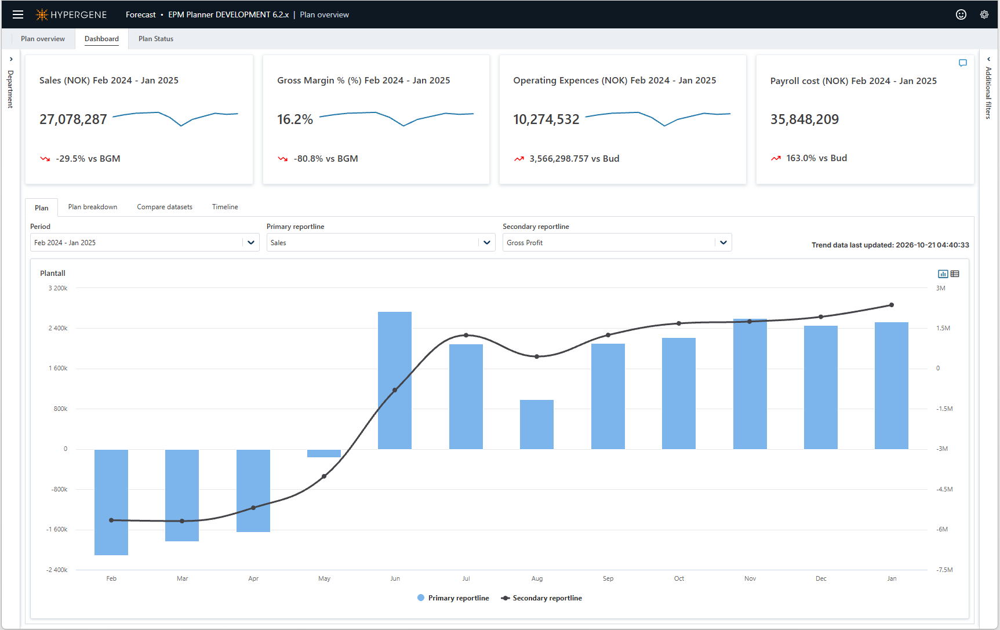
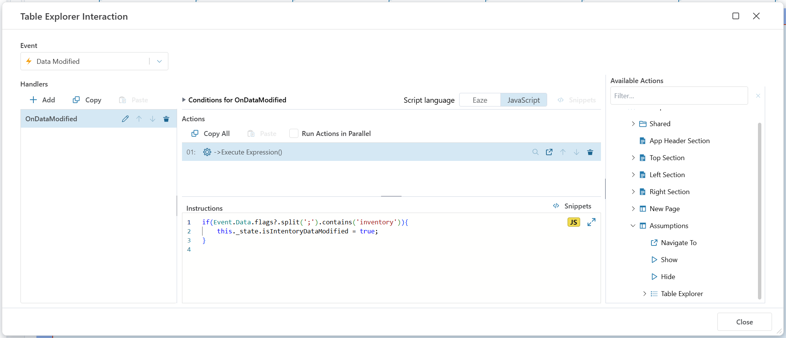

# InVision 2026.3 release notes

## AI: Semantic model for Budgeting and Forecasting
The InVision platform now ships with a built-in extension for the Budgeting and Forecasting solution that generates the semantic model for report data (KPIs) so AI tools like Claude and Copilot can talk to financal planning data through MCP for data exploration and analysis. The extension automatically applies the security policies already defined in the solution to the semantic model data, ensuring that AI tool users only see what they are allowed to.

The system automatically updates the security policies whenever permissions are changed, and when users are added or removed. 
After financial calculations has completed, new actuals has been loaded from ERP systems, and when the AI configuration for KPIs have changed, developers need to make sure to have hooked up an [Execute Profitbase B&F Semantic Model operation](../../flow/actions/profitbase-invision/epm/execute-semantic-model-operation.md) to their dataflows so the semantic model data gets updated accordingly. End users are not required to do anything.



<br/>

## KPI card enhancements

#### Filter binding
KPI cards can now be bound to filters in the Workbook Designer, meaning developers no longer need to pass arguments programatically using `SetParamValue(...)` when loading data. This unifies the KPI development experience with the Worksheet, Table and SQL Report way of doing things and reduces the need for script commands.  



<br/>

#### Programmatic configuration (advanced)
For advanced scenarios, KPI cards can now be configured dynamically (at runtime) to render conditionally based on business logic and state in Workbooks - for example variables and in-memory datasets already loaded into the browser app.  



<br/>

**Example - re-use in-memory dataset**  
Suppose your Workbook contains a tabular Sales report, and you want KPI cards to display data from the same dataset. To avoid a server roundtrip, you can now simply reference the dataset already loaded by the Sales Report and build the KPI card data.

```javascript
function getConfigOverride(args, app){
  // Use the app.datasets API to get a dataset already loaded to the Workbook.
  // app.datasets.getNames() to list the names of all in-memory datasets in the Workbook.
  const kpiDataTable = app.datasets.get('Sales Report Data');
  let sum = 0;
  for(const row of kpiDataTable.length){
      sum += row.Amount;
  }

  return {
      value: sum
  }
}
```

**Example - use variables and custom business logic**  
Another example shows how you can use Workbook variables (`app.variables`) and custom business logic to programatically define the KPI card data.  

```javascript
function getConfigOverride(args, app){
  let pctComplete = args.row.PctComplete;
  // In case we return a non-numeric value (string) from the database, convert it
  if(!app.lib.numerics.isNumber(pctComplete)){
    pctComplete = app.lib.numerics.convertToNumber(pctComplete);
  }
  const initialThreshold = app.variables.initialThreshold ?? 25;
  let status = 'halfway'
  if(pctComplete < initialThreshold){
    status = 'initial'
  }else if(pctComplete >= 95){
    status = 'complete'
  }

  return {
    status
  }
}
```

<br/>

## Table Explorer enhancements

#### Flags and Data modified event
Tables in the Table Explorer can now be annotated with **flags**: technical labels that describe the meaning or side effects of editing a table, for example `recalculate-forecast` or `affects-inventory`. Unlike table names and tags, which are for display, flags are for behavior. They let you define rules that span multiple tables, without depending on which tables are shown or how they are labeled.

When a user edits a table, the Table Explorer raises the **Data modified** event. The event now includes the table's flags in `Event.Data.flags` as a semicolon-separated string, so your event handler can take conditional action in the Workbook, such as marking data as edited or triggering a recalculation.

```javascript
if (Event.Data.flags?.split(';')?.includes('affects-inventory')) {
    this.app.variables._state.isInventoryEdited = true;
}
```



Read more in [How to use flags in the Table Explorer](../docs/tableexplorer/howto/flags.md).

<br/>

#### Other enhancements
- **Dynamic context scoping**: You can now programatically set the context scope by calling `SetContextFilter(...)` in the Load Data action of the Table Explorer. You'd typically do this to show only tables that are related to a specific business domain or process, for example `Sales` or `Forecast`.
- **Automatic grouping**: The Table Explorer now automatically groups tables by default if there are more than 2 tags and 10 tables displayed in the list.

<br/>

## APIs (Advanced)

#### Datasets API
The new Datasets API gives Workbook scripts access to the data that has been loaded into memory by Worksheets, SQL Reports and Tables. Use `this.app.datasets.getNames()` to list the names of all in-memory datasets, and `this.app.datasets.get(datasetName)` to retrieve a dataset as an array of objects.

```javascript
const rows = this.app.datasets.get('Customers');
let sum = 0;
for(const row of rows){
    sum += row.Amount;
}
```

Read more in [Datasets API](../docs/workbooks/programmingmodel/apis/datasets-apis.md).

<br/>

#### Flow service for OnSave handlers
The new `FlowService` lets you run a Flow when a Worksheet or Table is saved. Call `this.FlowService.Execute(...)` from any of the `On*` methods of the OnSave handler, either by Flow name only or with a custom object as parameter, for example to pass along the `CustomerId` of the saved row.

```csharp
protected override void OnEndSave(CudDataPackage data)
{
    data.Params.TryGetValue("@CustomerId", out var customerId);
    this.FlowService.Execute("Flow name", new () { Data = JsonSerialize(new { CustomerId = customerId })});
}
```

Read more in [Flow service](../docs/worksheets/onsave/flowservice.md).

<br/>


## Coming soon...
We've spent the past four months porting InVision Designer from a legacy desktop application to a modern web application. Soon you won't need to install anything on your computer to build InVision solutions and product extensions for the Budgeting and Forecasting solution.

Moving to the browser simplifies deployment and lets us ship faster. It also gives us a modern foundation for better tooling, so you can build solutions faster and maintain them more easily.

We're looking forward to a public reveal in the not so distant future. Stay tuned!