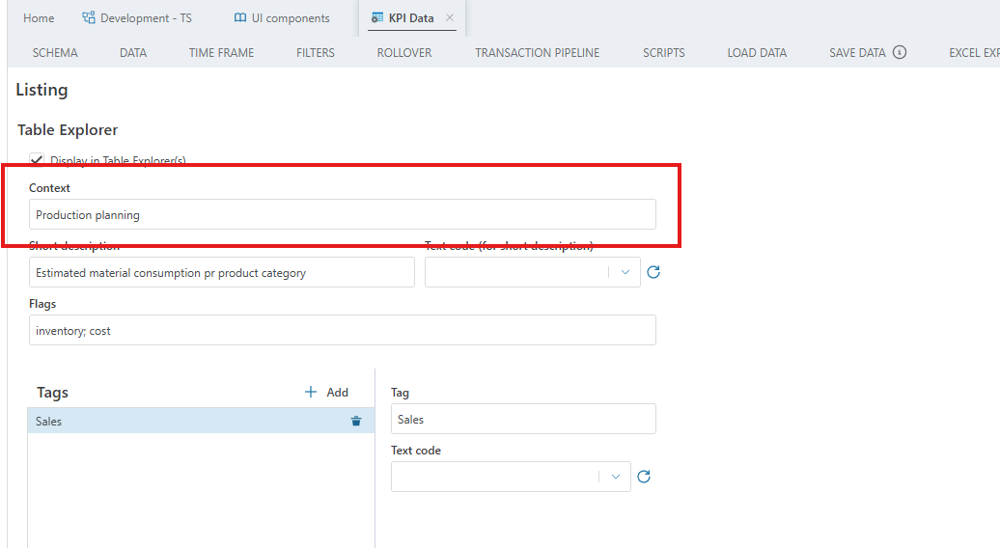
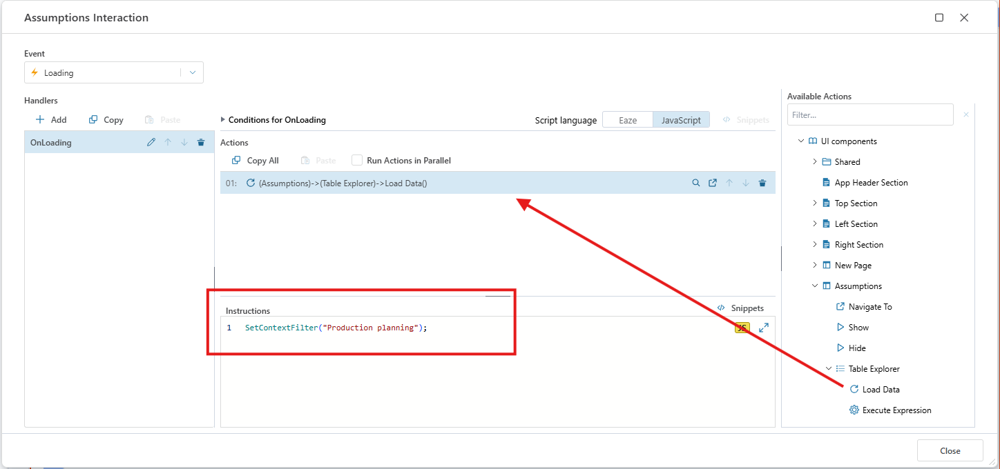
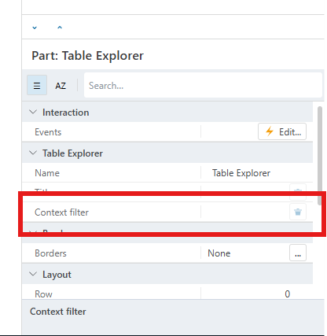

# How to use the Context Filter

A **Context** is a tag you assign to a Table so the **Table Explorer** can show only the tables that are relevant in a given situation. A context typically maps to a business domain, such as **ESG**, **Sales forecasting** or **Budget**.

Using the context filter takes two steps:

1. [Assign a context to your Tables](#step-1-assign-a-context-to-a-table).
2. [Scope a Table Explorer to that context](#step-2-scope-a-table-explorer-to-a-context), either dynamically or statically.

## Step 1: Assign a context to a Table

1. Open a Table from the Solution Explorer and go to the **Listing** tab.
2. Enable **Display in Table Explorer**.
3. Enter a **Context**. This is a free-form tag, so use any name that makes sense for your business domain.

## Step 2: Scope a Table Explorer to a context

Choose the option that fits your scenario:

- **Dynamic**: the context is decided at runtime, for example from a Workbook variable.
- **Static**: the Table Explorer always shows the same context.

### Option 1: Dynamic scope

1. Open (or create) a Workbook from the Solution Explorer.
2. Add a Table Explorer component to the Workbook if it doesn't have one.
3. Open the event that loads the Table Explorer. For example, select the Page and click **Events** in the property editor on the right.
4. Edit (or add) the event, for example the Page **Loading** event.
5. Add the **Load Data** action from the Table Explorer component.
6. In the **instructions** editor, call `SetContextFilter(...)`.

> [!NOTE]
> The context is only evaluated the first time Load Data runs. Calling Load Data with `SetContextFilter(...)` again has no effect.

### Option 2: Static scope

1. Open (or create) a Workbook from the Solution Explorer.
2. Add a Table Explorer component to the Workbook if it doesn't have one.
3. Select the Table Explorer component.
4. In the **property editor**, enter the context in the context filter field.

