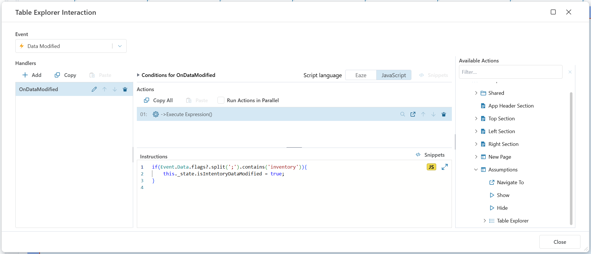

# How to use flags in the Table Explorer

Flags describe the _meaning_ or _side effects_ of editing a table in a Table Explorer. When a user edits a table, the Table Explorer raises an event that includes the table's flags. Your event handler can then decide what to do based on those flags.

Examples of flags are `recalculate-forecast` and `affects-inventory`.

## Why use flags instead of table names or tags?

- **You don't always know which tables are displayed.** A Table Explorer can show any number of tables, and you may not know which ones.
- **Not every edit has the same effect.** Editing an employee name doesn't change a forecast, but editing a bonus percentage does. Flags let you mark which tables need a recalculation.
- **Names and tags are for display. Flags are for behavior.** Table names and tags belong to the UI. Flags are technical annotations that let you standardize what happens when a table is edited, without depending on how the table is labeled.

## Handle flags in the Data modified event

When a user edits a table, the [Data modified](../../workbooks/components/table-explorer.md#data-modified-event-args) event is raised. The flags defined on the table are available in `Event.Data.flags` as a semicolon-separated string, for example `recalculate-forecast;affects-inventory`.

Split the string to check for a specific flag.

**Example**

This handler marks the inventory as edited when the edited table has the `affects-inventory` flag:

```javascript
if (Event.Data.flags?.split(';')?.includes('affects-inventory')) {
    this.app.variables._state.isInventoryEdited = true;
}
```


